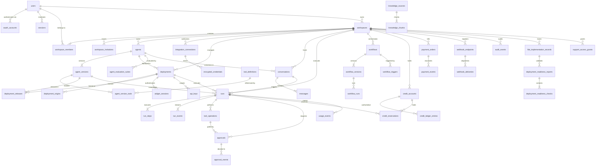
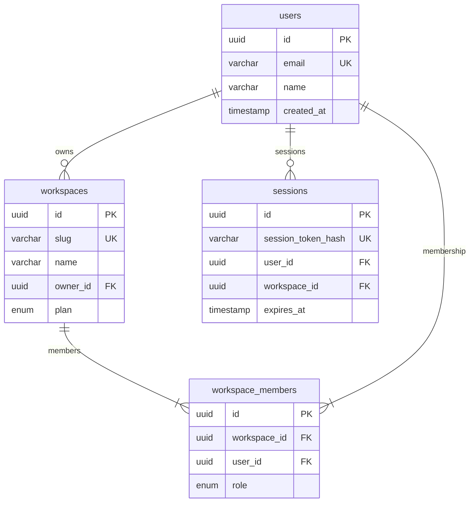
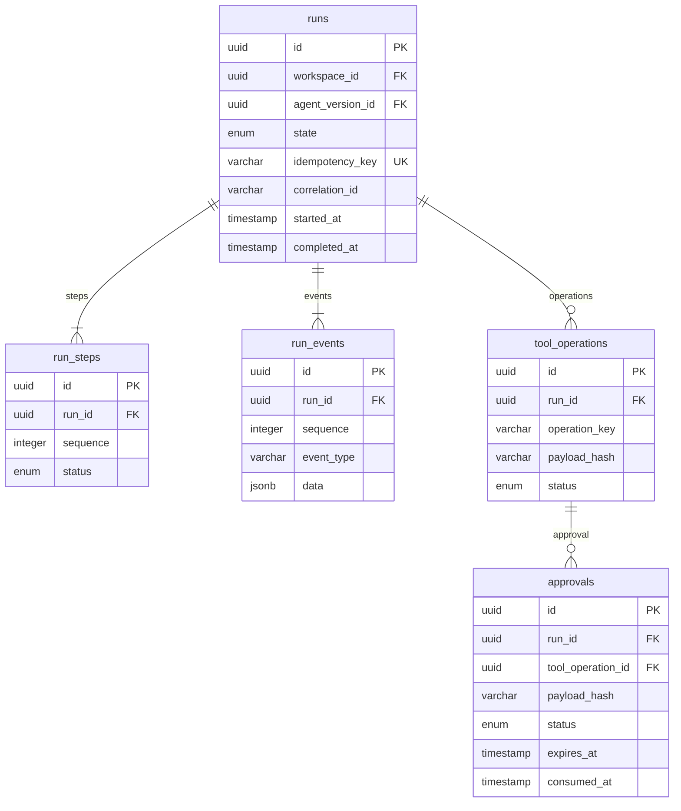
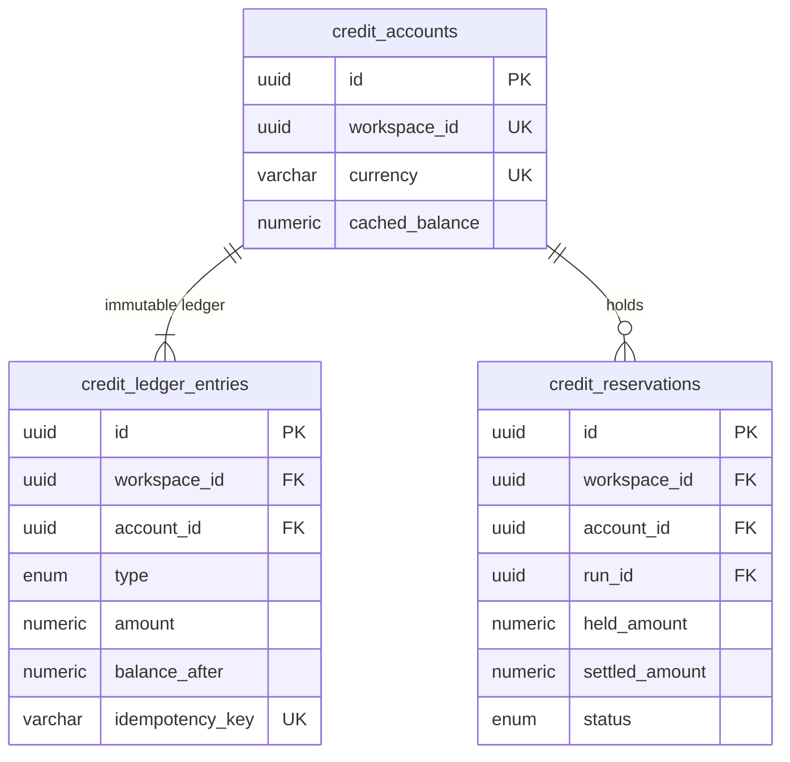
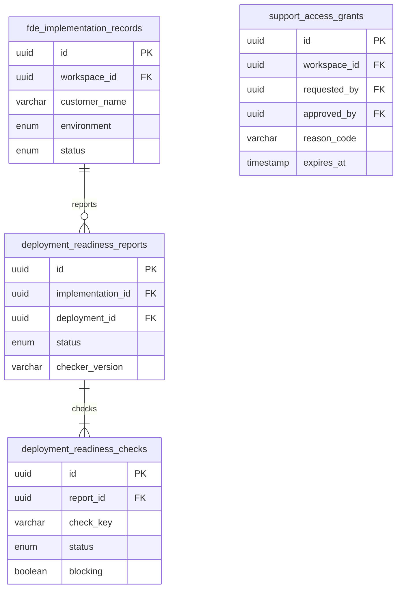

# AgentFlow OS — Entity Relationship Diagram (ERD)

## Core Domain Relationships

---

## Detailed Relational Models

### 1. Identity & Tenancy

### 2. Runtime Execution & Approvals

### 3. Financial Ledger & Idempotency

### 4. FDE & Customer Operations

