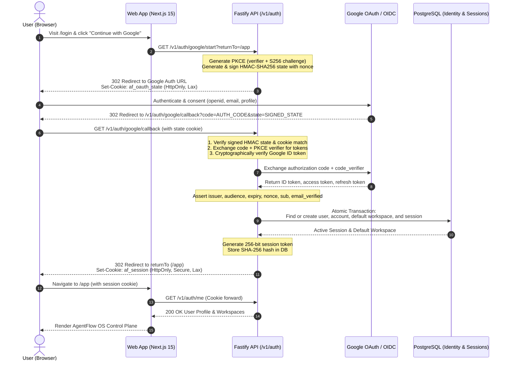

# AgentFlow OS — Authentication Architecture & Google OpenID Connect Specification

**Document Version**: 1.0  
**Baseline Date**: 2026-11-04  
**Status**: Authoritative Security Specification  
**Implementation Stage**: Stage 07 (Production Authentication, Google OAuth, and Session Management)  

---

## 1. Architectural Overview

AgentFlow OS implements an enterprise-grade, identity-first control plane architecture. The authentication system relies on **Google OpenID Connect (OIDC)** using the **Authorization Code Flow with Proof Key for Code Exchange (PKCE, RFC 7636)** and cryptographically signed state parameters.

All identity assertions originate from verified identity tokens cryptographically signed by Google's public key infrastructure and validated via `google-auth-library`. No client-supplied email, user ID, or role can elevate privileges or establish an unverified session.



---

## 2. Google OAuth 2.0 / OpenID Connect Specification

### 2.1 Standard Scopes
The control plane requests the minimum necessary scopes to establish identity:
- `openid`: Standard OpenID Connect claim identifier.
- `email`: User's primary email address and verification status (`email_verified`).
- `profile`: User's display name, given name, family name, and avatar picture.

### 2.2 PKCE (Proof Key for Code Exchange)
To protect authorization codes from interception and injection attacks:
1. Fastify API generates a cryptographically random 32-byte code verifier encoded as `base64url` (`generatePkcePair`).
2. API calculates the SHA-256 digest of the verifier and encodes it as `base64url` to create the `code_challenge`.
3. The authorization URL is formatted with `code_challenge_method=S256` and `code_challenge=<challenge>`.
4. The raw code verifier is embedded within the cryptographically signed state token.

### 2.3 Signed State Token & CSRF Protection
To guarantee state integrity and prevent cross-site request forgery during authentication:
1. The state payload contains:
   ```json
   {
     "nonce": "hex-encoded 32-byte random string",
     "codeVerifier": "base64url PKCE verifier",
     "returnTo": "/app",
     "createdAt": 1730740000000
   }
   ```
2. The payload is serialized, base64url-encoded, and signed using HMAC-SHA256 with the server's `SESSION_SECRET`:
   $$\text{Signature} = \text{HMAC-SHA256}(\text{payload}, \text{SESSION\_SECRET})$$
   $$\text{State Token} = \text{payload} + "." + \text{Signature}$$
3. Fastify writes the state token to a temporary cookie (`af_oauth_state`) with `HttpOnly`, `SameSite=Lax`, and a 10-minute time-to-live.
4. When Google redirects back to `/v1/auth/google/callback`, Fastify:
   - Verifies the state query parameter against the `SESSION_SECRET`.
   - Compares the state query parameter against the `af_oauth_state` cookie using constant-time comparison (`crypto.timingSafeEqual`).
   - Validates that `createdAt` is within the last 10 minutes (rejecting replay attacks).

### 2.4 Cryptographic ID Token Verification
The callback handler exchanges the authorization code using `OAuth2Client.getToken()` and verifies the received ID token via `OAuth2Client.verifyIdToken()`:
- **Signature & Key Rotation**: Uses Google's published JWKS certs (`https://www.googleapis.com/oauth2/v3/certs`) to verify RSA-256 signatures.
- **Audience**: Validates `aud === GOOGLE_CLIENT_ID`.
- **Issuer**: Validates `iss === 'accounts.google.com'` or `iss === 'https://accounts.google.com'`.
- **Expiration**: Validates `exp > currentTime`.
- **Nonce**: Verifies that the token's `nonce` claim matches the state's `nonce`.
- **Email Verification**: Explicitly requires `payload.email_verified === true`. Unverified Google accounts are rejected with an authentication error.

---

## 3. Identity Provisioning & Account Linking Security Rules

All identity mutations execute inside an atomic PostgreSQL transaction in `IdentityRepository.findOrCreateUserFromGoogle`:

### 3.1 New User Flow
1. If no `oauth_accounts` row exists matching `provider = 'google'` and `provider_account_id = sub`:
2. If no `users` row exists matching `email = verified_email`:
   - Create new `users` record (`role = 'member'`, `status = 'active'`, `email_verified = true`).
   - Create new `oauth_accounts` record linked to the user.
   - Create default personal workspace (`name = "<User Name>'s Workspace"`, `slug = "<slug>-<short-id>"`).
   - Create `workspace_memberships` record granting `role = 'owner'`.
   - Emit audit log record.

### 3.2 Returning User Flow
1. If an `oauth_accounts` row exists matching `provider = 'google'` and `provider_account_id = sub`:
   - Update user display name and avatar URL if updated in Google profile.
   - Update OAuth tokens (`access_token`, `refresh_token`, `token_expires_at`).
   - Load user's active workspaces and memberships.

### 3.3 Anti-Account-Takeover Rule
> [!CRITICAL]
> **Strict Collision Prohibition**: If a `users` record exists with the incoming email, but no `oauth_accounts` record exists linking that Google subject ID (`sub`) to that user, **the system refuses automatic email-only merging**.
> 
> Automatic linking on email collision allows malicious third parties or compromised OAuth scopes on external providers to hijack an existing AgentFlow OS account. The API throws `ConflictError("An account with this email already exists with a different sign-in method")`. Explicit credential-authenticated linking is required.

---

## 4. Google Cloud Console Configuration Guide

To configure Google OAuth for development and production:

1. **Create or Select a Google Cloud Project**:
   - Navigate to [Google Cloud Console](https://console.cloud.google.com/).
   - Create a project (e.g., `agentflow-os-prod`).

2. **Configure OAuth Consent Screen**:
   - User Type: **External** (or **Internal** for Google Workspace organizations).
   - App Name: `AgentFlow OS`.
   - User support email & Developer contact info: your domain admin.
   - Scopes: Add `.../auth/userinfo.email`, `.../auth/userinfo.profile`, `openid`.

3. **Create OAuth 2.0 Client Credentials**:
   - Application Type: **Web application**.
   - Name: `AgentFlow OS Control Plane`.
   - **Authorized JavaScript origins**:
     - Development: `http://localhost:3000`, `http://localhost:4000`
     - Production: `https://app.agentflow.io`, `https://api.agentflow.io`
   - **Authorized redirect URIs**:
     - Development: `http://localhost:4000/v1/auth/google/callback`
     - Production: `https://api.agentflow.io/v1/auth/google/callback`

4. **Populate Environment Variables**:
   ```bash
   GOOGLE_CLIENT_ID="<your-client-id>.apps.googleusercontent.com"
   GOOGLE_CLIENT_SECRET="GOCSPX-<your-client-secret>"
   GOOGLE_OAUTH_REDIRECT_URI="http://localhost:4000/v1/auth/google/callback"
   AUTH_ALLOWED_REDIRECT_ORIGINS="http://localhost:3000,http://localhost:4000"
   ```
