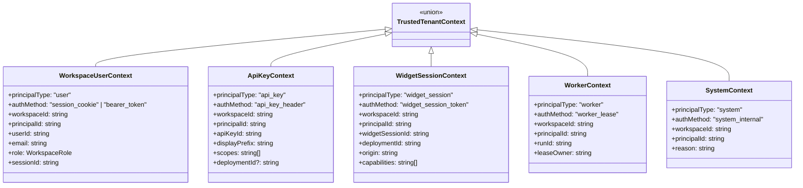
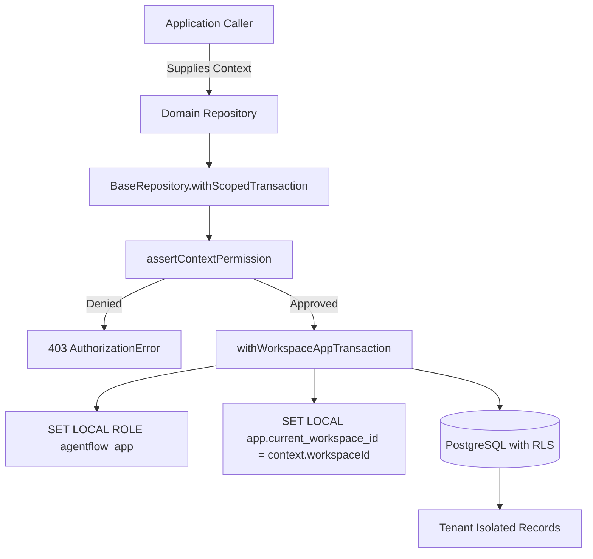

# AgentFlow OS — Tenant Access Model & Data Access Security

**Document Version**: 1.0  
**Baseline Date**: 2026-11-04  
**Status**: Authoritative Security Architecture Specification  
**Governing ADR**: ADR-002, ADR-003, ADR-007, ADR-021  

---

## 1. Core Architectural Tenancy Invariant

In NexOps / AgentFlow OS, tenant identity is **strictly established from a cryptographically verified authentication mechanism**, never accepted from an arbitrary request parameter, query string, or client-controlled header.

$$\text{Tenant Context} = \text{Resolver}(\text{Verified Credential}) \neq \text{Request Parameter}$$

A client-supplied workspace ID (e.g. in a route parameter `/workspaces/:workspaceId`) serves purely as a **routing hint** or an **access claim**. The application data access layer verifies that the authenticated principal possesses an active membership and role in that exact workspace before any database transaction context is established.

---

## 2. Discriminated Context Architecture

All data access operations require a strongly-typed tenant context implementing the `TrustedTenantContext` discriminated union defined in [`packages/database/src/tenant-context.ts`](file:///Users/anny/Desktop/NexOps/packages/database/src/tenant-context.ts):



### Context Types and Privileges

| Principal Type | Authentication Method | Identity Source | Capabilities & Boundaries |
| :--- | :--- | :--- | :--- |
| `user` | `session_cookie`, `bearer_token` | Active session token hash mapped to `users` and `workspace_members` | Full workspace permissions mapped from `WorkspaceRole` (`owner`, `admin`, `member`, `viewer`). |
| `api_key` | `api_key_header` | Constant-time SHA-256 hash match on `api_keys` | Restricted to explicit `scopes` (`agent:read`, `run:create`, etc.). Cannot delete workspaces. |
| `widget_session` | `widget_session_token` | Ephemeral session token with verified origin against `deployment_origins` | Bounded capabilities (`run:create`, `run:read`, `conversation:read`, `conversation:write`). No admin access. |
| `worker` | `worker_lease` | Anchored directly to durable `runs` record in PostgreSQL | Scoped exclusively to the workspace of the leased `runId`. Ignores queue payload claims. |
| `system` | `system_internal` | Internal service authority with mandatory audit reason | System maintenance operations, reconciliation jobs, and background indexing. |

---

## 3. Four Authentication & Resolution Paths

Context resolution is implemented in [`packages/database/src/resolvers.ts`](file:///Users/anny/Desktop/NexOps/packages/database/src/resolvers.ts). Unverified claims are rejected immediately.

### 1. Browser Session Resolver (`resolveSessionContext`)
- Computes SHA-256 hash of provided session token.
- Validates that the session exists, `revoked_at IS NULL`, and `expires_at > NOW()`.
- Distinguishes expired (401) vs revoked (401) sessions with explicit diagnostics.
- Verifies that the user exists and holds an active membership record in `workspace_members`.
- Rejects removed, suspended, or missing memberships with `403 AuthorizationError`.

### 2. Server API Key Resolver (`resolveApiKeyContext`)
- Requires prefix `af_live_` or `af_test_`.
- Computes SHA-256 hash and performs constant-time equality comparison (`crypto.timingSafeEqual`) to prevent timing side-channel attacks.
- Enforces `status = 'active'`, `revoked_at IS NULL`, and `expires_at > NOW()`.
- Extracts explicit allowed scopes and binds workspace identity stored on the key.

### 3. Public Widget Session Resolver (`resolveWidgetSessionContext`)
- Validates widget session token hash, active status, and expiry.
- Resolves associated deployment and verifies `deployments.status = 'active'`.
- Enforces strict origin allowlist against `deployment_origins` where `status = 'verified'`.
- Normalized origin comparison prevents subdomain or protocol spoofing.

### 4. Durable Worker Run Resolver (`resolveWorkerContext`)
- Worker nodes never trust queue payload workspace identifiers.
- Context is resolved by querying `runs.workspaceId` directly from the durable PostgreSQL database.
- Spoofed queue message payloads cannot trick background workers into cross-tenant execution.

---

## 4. Programmatic Data Access Layer & Repositories

Backend services access data exclusively through tenant-scoped repositories derived from `BaseRepository`:



### Complete Repository Inventory

| Domain | Repository Class | Key Scoped Methods | Enforced Permissions |
| :--- | :--- | :--- | :--- |
| **Workspaces** | `WorkspaceRepository` | `findById`, `update`, `listMembers`, `addMember`, `removeMember` | `workspace:read`, `workspace:update`, `member:manage` |
| **Agents** | `AgentRepository` | `list`, `findById`, `create`, `update`, `archive`, `createVersion`, `listVersions` | `agent:read`, `agent:create`, `agent:update`, `agent:publish` |
| **Deployments** | `DeploymentRepository` | `list`, `findById`, `create`, `promoteVersion`, `addOrigin`, `listOrigins` | `workspace:read`, `workspace:update`, `agent:publish` |
| **Conversations** | `ConversationRepository` | `list`, `findById`, `create`, `addMessage`, `listMessages` | `run:read`, `run:create` |
| **Runs** | `RunRepository` | `list`, `findById`, `create`, `updateState`, `addEvent`, `listEvents`, `createToolOperation` | `run:read`, `run:create` |
| **Approvals** | `ApprovalRepository` | `list`, `findById`, `create`, `resolve`, `consume` | `run:read`, `approval:resolve` |
| **Integrations** | `IntegrationRepository` | `listConnections`, `findConnectionById`, `createConnection`, `storeEncryptedCredentials`, `findEncryptedCredentials` | `integration:manage` |
| **Billing** | `BillingRepository` | `getOrCreateAccount`, `recordLedgerEntry`, `createReservation`, `settleReservation`, `releaseReservation`, `recordUsage`, `listLedgerEntries` | `billing:manage` |
| **Payments** | `PaymentRepository` | `createOrder`, `findOrderById`, `listOrders`, `recordEvent` | `billing:manage` |
| **Knowledge** | `KnowledgeRepository` | `listSources`, `findSourceById`, `createSource`, `updateSourceStatus`, `addChunks`, `listChunks`, `deleteSource` | `agent:read`, `agent:update` |
| **Webhooks** | `WebhookRepository` | `listEndpoints`, `findEndpointById`, `createEndpoint`, `updateEndpointStatus`, `recordDelivery`, `listDeliveries` | `integration:manage` |
| **FDE** | `FdeRepository` | `listRecords`, `findRecordById`, `createRecord`, `createReadinessReport`, `addReadinessCheck`, `grantSupportAccess` | `workspace:read`, `workspace:update` |
| **Audit** | `AuditRepository` | `recordEvent` (append-only), `listEvents`, `createNotification`, `listNotifications`, `markNotificationRead` | `workspace:read` |
| **Tools** | `ToolRepository` | Global catalogue reads (`listActiveTools`, `findToolByKey`) + workspace version bindings (`bindToolToVersion`, `listVersionTools`) | Public catalogue / `agent:update` |

---

## 5. Row-Level Security & Connection Pool Hardening

### Least-Privilege Role `agentflow_app`
All application queries execute under the unprivileged PostgreSQL role `agentflow_app`:
```sql
SET LOCAL ROLE agentflow_app;
SELECT set_config('app.current_workspace_id', 'aaaaaaaa-aaaa-4aaa-8aaa-aaaaaaaaaaaa', true);
```

### Transaction-Local Parameter Guarantees (`is_local = true`)
- Setting `is_local = true` ensures that PostgreSQL automatically clears `app.current_workspace_id` when the transaction ends (commit or rollback).
- No manual teardown is required to prevent cross-request leakage.
- Direct pool inspection immediately following a transaction confirms `current_setting('app.current_workspace_id', true)` is empty/null.

### Dual-Layer Defense Matrix
1. **Application Layer**: Discriminated union types, schema validation, and RBAC permission guards (`assertContextPermission`) reject unauthorized calls before touching the database.
2. **Database Layer**: PostgreSQL RLS policies unconditionally filter and reject cross-workspace reads, updates, and deletes, even if application logic were compromised.
3. **Database Triggers**: Append-only immutability triggers block UPDATE/DELETE on audit logs, approval events, and financial ledgers, even against admin transactions.

---

## 6. Verification Evidence: 24 Security Scenarios

The complete 24-point security test suite in [`packages/database/tests/database-access-security.test.ts`](file:///Users/anny/Desktop/NexOps/packages/database/tests/database-access-security.test.ts) executes against the live PostgreSQL 16.4 Alpine container:

```
✓ tests/database.test.ts (5 tests)
✓ tests/database-integration.test.ts (22 tests)
✓ tests/database-access-security.test.ts (24 tests)
  ✓ Scenario 1: Cross-workspace agent reads are completely invisible to other tenants
  ✓ Scenario 2: Cross-workspace deployment reads fail and return TenantNotFoundError
  ✓ Scenario 3: Cross-workspace conversation reads fail closed with TenantNotFoundError
  ✓ Scenario 4: Cross-workspace approval query and resolution are rejected
  ✓ Scenario 5: Cross-workspace integration connections cannot be viewed or accessed
  ✓ Scenario 6: Cross-workspace encrypted credentials cannot be retrieved
  ✓ Scenario 7: Cross-workspace billing ledgers and accounts are segregated
  ✓ Scenario 8: Cross-workspace audit log events remain strictly segregated
  ✓ Scenario 9: Attempting to insert child records against a cross-workspace parent is rejected
  ✓ Scenario 10: Cross-workspace entity updates and deletions fail closed
  ✓ Scenario 11: Malformed or unverified context fails immediately before DB query
  ✓ Scenario 12: Revoked browser session credentials are rejected with 401 AuthenticationError
  ✓ Scenario 13: Expired browser session credentials are rejected with 401 AuthenticationError
  ✓ Scenario 14: Valid user session requesting unauthorized workspace is rejected with 403 AuthorizationError
  ✓ Scenario 15: Unknown or malformed API key is rejected with 401 AuthenticationError
  ✓ Scenario 16: Revoked API key is rejected with 401 AuthenticationError
  ✓ Scenario 17: API key with narrow scopes is blocked from unauthorized actions (403)
  ✓ Scenario 18: Forged or non-existent widget session token is rejected with 401
  ✓ Scenario 19: Expired widget session is rejected with 401 AuthenticationError
  ✓ Scenario 20: Widget session with unapproved origin or attempting unauthorized operations is rejected (403)
  ✓ Scenario 21: Worker context strictly anchors to durable run in PostgreSQL and ignores forged queue workspaceId
  ✓ Scenario 22: RLS tenant session variables never leak across pooled connections
  ✓ Scenario 23: Transaction rolls back completely on error and leaves no dirty state
  ✓ Scenario 24: Calling resetWorkspaceContext restores default pool state and clears RLS role

Test Files  3 passed (3)
Tests       51 passed (51)
```
